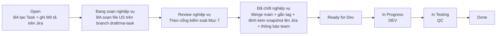

# WORKFLOW QUẢN LÝ NGHIỆP VỤ CITYBUS
## Quy trình làm việc giữa BA – QC – DEV – Quản lý và quản lý tài liệu nghiệp vụ

| | |
|---|---|
| **Phiên bản** | 1.1 — ngày 27/11/2026 (v1.0 cùng ngày; v1.1 bổ sung: file Core dùng nạp ngữ cảnh AI, biên bản họp theo dự án, báo cáo ngày trước 16:00 — xem Mục 14) |
| **Trạng thái** | Bản chốt để trình team/Quản lý và áp dụng thử (pilot) |
| **Người chịu trách nhiệm** | BA (Business Analyst) — chủ trì nghiệp vụ |
| **Phạm vi áp dụng** | Các dự án thuộc hệ thống Citybus (FUTA) |
| **Tài liệu gốc** | Biên bản phỏng vấn/chốt quyết định 26–27/11/2026 (`phong-van/2026-11-26-workflow-quan-ly-nghiep-vu-citybus.md`) |

> Các mục có dấu ⚠ là **tạm chốt** — sẽ rà soát lại sau giai đoạn pilot (xem Mục 12).

---

## 1. Mục tiêu

1. Đảm bảo QC, DEV và Quản lý **nắm đúng cùng một bản nghiệp vụ** trước khi làm chuyên môn, ở cả 3 tầng: nghiệp vụ chung Citybus, nghiệp vụ riêng từng dự án, và nghiệp vụ cụ thể theo từng User Story (US).
2. Có **một chỗ tập trung duy nhất** để team lấy về (clone) bản nghiệp vụ đầy đủ và mới nhất, thay vì nghiệp vụ nằm rải rác trên chat, file rời hoặc từng Task Jira cũ mà không ai cập nhật nữa.
3. Kiểm soát chất lượng nghiệp vụ ngay từ đầu vào, đặc biệt với US có dùng AI hỗ trợ soạn thảo.

## 2. Nguyên tắc chung

- **BA là người chịu trách nhiệm chính về nghiệp vụ đúng.** BA là người chốt và phát hành tài liệu nghiệp vụ chính thức cho team.
- **Cổng "Nghiệp vụ Đúng":** thông tin trao đổi trên chat/email khi chưa có Task Jira chính thức thì **chưa phải nghiệp vụ chuẩn** — chỉ là thông tin chờ xử lý.
- Nghiệp vụ được tổ chức thành **3 tầng**:
  - **Tầng 1 — Nghiệp vụ chung Citybus:** quy tắc dùng chung toàn hệ thống (ví dụ: vai trò TTCC/GoLab, GoPS/GoAFC, quy trình eLVC...).
  - **Tầng 2 — Nghiệp vụ riêng từng dự án:** phần khác biệt của từng dự án (ví dụ: Smartbus App vs GoPS App, Smartbus App vs VNPay App, App điều hành tài xế trên Tablet).
  - **Tầng 3 — Nghiệp vụ theo US:** chi tiết của từng Task Jira.
- **Không ghi mật khẩu thật vào git.** File môi trường chỉ ghi URL, tên tài khoản và nơi lấy mật khẩu.

## 3. Mô hình quản lý tài liệu: 2 lớp

| Lớp | Là gì | Vai trò |
|---|---|---|
| **Lớp 1 — Kho nghiệp vụ chính** | Repo Git thuộc **sở hữu công ty**, BA là maintainer | Nơi chứa bản nghiệp vụ **đầy đủ và mới nhất**; QC/DEV vào đây clone về để làm việc |
| **Lớp 2 — Lưu vết trên Jira** | Mô tả (Description) của Task + file Markdown snapshot đính kèm tại thời điểm chốt + các comment thay đổi | Cơ sở lưu vết chính thức trên hệ thống công ty; BA **không** phải quay lại cập nhật từng Task cũ |

Lý do cần Lớp 1: khối lượng việc của BA rất lớn, không thể nhớ và cập nhật ngược từng Task Jira cũ mỗi khi nghiệp vụ thay đổi. Kho chính thuộc sở hữu công ty (không phải repo cá nhân) để tránh rủi ro tài liệu mất khi BA nghỉ việc; khi BA chuyển giao, quyền maintainer được bàn giao cho người kế nhiệm.

## 4. Cấu trúc kho nghiệp vụ chính

```text
futa-citybus/
├── README.md                    # Cổng vào: hướng dẫn clone, bản đồ tài liệu, tóm tắt quy trình này
├── 00-inbox/                    # Sổ tiếp nhận thông tin thô của BA theo ngày (YYYY-MM/YYYY-MM-DD.md)
│                                # Nguồn: chat/email/yêu cầu từ vận hành, đối tác
│                                # Trạng thái mỗi mục: "Chờ lên Jira" / "Đã lên Jira [link task]"
├── 01-core-wiki/                # TẦNG 1 — Nghiệp vụ chung Citybus
│   ├── 00-nghiep-vu-core-citybus.md  # File Core duy nhất, tự chứa — dùng để nạp ngữ cảnh cho AI
│   ├── 01-web-admin.md
│   ├── 02-onbus-hardware.md
│   ├── 03-mobile-app-driver.md
│   └── 04-api-integration/      # API tách 4 nhóm: nội bộ FUTA / thanh toán / thiết bị-GPS / đối tác vận hành
├── 02-projects/                 # TẦNG 2 + TẦNG 3 — Hồ sơ từng dự án
│   └── 2026-q4-<ten-du-an>/     # Tên thư mục: <YYYY>-q<quý>-<tên ngắn, kebab-case, không dấu>
│       ├── README.md            # Mục lục của dự án
│       ├── <nghiep-vu-du-an>.md # Nghiệp vụ riêng của dự án
│       ├── api-integration.md   # Tích hợp API riêng của dự án
│       ├── us/                  # TẦNG 3 — File Markdown theo từng Task Jira
│       └── bien-ban-hop/        # Biên bản họp của dự án: YYYY-MM/YYYY-MM-DD.md
├── 03-resources/                # Tài nguyên phục vụ BA đối chiếu: môi trường (chỉ URL/tài khoản/nơi lấy mật khẩu),
│                                # danh mục thiết bị và đối tác liên quan nghiệp vụ
├── 04-bao-cao-ngay/             # Báo cáo hằng ngày của BA gửi cấp trên trước 16:00: YYYY-MM/YYYY-MM-DD.md
└── 99-templates/                # Template dự án, template US, template Hiện trạng + Thay đổi,
                                 # template biên bản họp, template báo cáo ngày, checklist review AI
```

*Cấu trúc này được tối ưu riêng cho vai trò BA, có tham khảo cấu trúc kho tri thức của QC. Bảng đối chiếu chi tiết điểm giống/khác với bản QC nằm tại `phong-van/doi-chieu-cau-truc-BA-vs-QC-tham-khao.md`.*

## 5. Vai trò và phân quyền

| Vai trò | Quyền và trách nhiệm |
|---|---|
| **BA (maintainer)** | Soạn nghiệp vụ trên branch riêng; review và **là người duy nhất merge vào `main`**; đánh tag; đính kèm snapshot lên Jira; thông báo bản mới cho team |
| **QC** | Đọc/clone bản chốt từ `main`; góp ý, phát hiện sai → comment vào Task Jira để BA sửa; có quyền **trả task về** nếu file US thiếu thông tin bắt buộc (xem Mục 7) |
| **DEV** | Như QC: đọc/clone, góp ý qua comment, không tự sửa nội dung nghiệp vụ trong kho |
| **Quản lý** | Nắm tiến độ và nội dung qua Jira và thông báo của BA; là đầu mối nắm rủi ro nhân sự BA (xem Mục 13) |

**Quy tắc khi BA vắng:** hiện team chỉ có 1 BA và **chưa có người dự phòng merge**. Trong thời gian BA vắng, việc merge vào `main` **đóng băng**; team chuyển sang làm task của dự án khác hoặc chờ BA quay lại. Đây là rủi ro đã được ghi nhận và chấp nhận tạm thời (Mục 13).

## 6. Quy trình xử lý một Task (workflow Jira) ⚠

Chuỗi trạng thái của 1 Task từ lúc tạo đến khi hoàn thành:

```text
Open → Đang soạn nghiệp vụ → Review nghiệp vụ → Đã chốt nghiệp vụ
     → Ready for Dev → In Progress → In Testing → Done
```



Việc của BA ở từng chặng:

1. **Tiếp nhận:** thông tin thô (chat/email/yêu cầu) được ghi vào `00-inbox/` theo ngày, đánh dấu "Chờ lên Jira".
2. **Open:** BA tạo Task Jira, ghi nghiệp vụ vào phần Mô tả theo cách truyền thống; mục trong inbox chuyển thành "Đã lên Jira [link]".
3. **Đang soạn nghiệp vụ:** BA soạn file US (theo template Mục 8) trên branch `draft/<mã task>` trong kho chính, đồng thời bổ sung file Markdown tóm tắt nghiệp vụ của task.
4. **Review nghiệp vụ:** qua cổng kiểm soát ở Mục 7.
5. **Đã chốt nghiệp vụ:** BA merge vào `main`, gắn **tag theo ngày + mã Task Jira** ⚠ (định dạng tạm: `2026-11-26_CITY-1234`), đính kèm bản snapshot của file US vào Task Jira, và thông báo cho team (Mục 10).
6. **Ready for Dev → Done:** DEV/QC làm việc dựa trên bản đã chốt trong kho và trên Task.

## 7. Cổng kiểm soát US có dùng AI hỗ trợ

Vấn đề cần kiểm soát: BA có thể dùng AI hỗ trợ tạo US; nếu không review mà xuất thẳng thành tài liệu chính thức, nội dung chưa kiểm chứng sẽ đi thẳng xuống QC/DEV. Quy định:

- Bản do AI tạo **chỉ là bản Draft**, không phải tài liệu chính thức.
- **Mọi file US bắt buộc có phần đầu gồm:** Nguồn đối chiếu / Người review / Ngày review. **Thiếu một trong các mục này, QC/DEV có quyền trả Task về.**
- Mức review phân tầng theo rủi ro:

| Loại US | Mức kiểm soát |
|---|---|
| US thông thường | BA **tự review theo checklist** (trong `99-templates/`) và comment ký xác nhận trên Jira |
| US đụng tới **tiền / trợ giá / thanh toán / đối soát** (vé, eLVC, VNPay...) | **Bắt buộc peer review bởi người thứ hai** trước khi chốt |

Nội dung checklist review (file riêng trong `99-templates/`): đối chiếu mọi con số, mốc giờ, tên hệ thống với nguồn gốc; không có business rule nào không có nguồn; thuật ngữ đúng chuẩn (TTCC / GoLab / GoAFC / GoPS...); mọi Acceptance Criteria đều kiểm thử được; đã xét các trường hợp ngoại lệ.

## 8. Template file US (Tầng 3)

Mỗi file US trong thư mục `us/` của dự án gồm:

- **Phần đầu:** mã Task, dự án, link tới tài liệu Tầng 1/Tầng 2 liên quan, Nguồn đối chiếu, Người review, Ngày review, trạng thái (Draft/Đã chốt), tag.
- **Phần thân:** Mục tiêu · Phạm vi (làm / không làm) · Actor · Luồng chính · Luồng ngoại lệ · Business Rules (đánh số `BR-...`) · Acceptance Criteria dạng Given/When/Then (đánh số `AC-...`) · Dữ liệu/API liên quan · Câu hỏi còn mở.
- Mục **Hiện trạng + Thay đổi**: chỉ bắt buộc khi sửa tính năng cũ (xem Mục 9).
- Mục nào không áp dụng thì ghi **"Không áp dụng"**, không xóa mục — để người đọc biết là đã xét rồi, không phải bị bỏ quên.

## 9. Quy định theo loại dự án

Dự án gồm 2 loại:

**Loại 1 — Dự án mới:** áp dụng quy trình chuẩn từ đầu (Mục 6), dễ kiểm soát.

**Loại 2 — Dự án đang làm**, gồm 2 trường hợp:

| Trường hợp | Yêu cầu tài liệu |
|---|---|
| Làm **tính năng mới** trên hệ thống đang chạy | File US chỉ cần link về Tầng 1/Tầng 2 và ghi phần mới |
| **Sửa tính năng cũ** | File US **bắt buộc** có 2 phần: **"Hiện trạng đang chạy"** (tính năng hiện tại vận hành thế nào) và **"Thay đổi yêu cầu"**. QC dùng phần Hiện trạng để test regression cho phần không thay đổi |

## 10. Thay đổi nghiệp vụ sau khi đã chốt & thông báo bản mới

**Khi nghiệp vụ thay đổi sau trạng thái "Đã chốt nghiệp vụ":**

| Tình trạng Task | Cách xử lý |
|---|---|
| **Chưa Done** | Sửa tại chỗ trên chính Task đó: BA mở branch draft mới, merge và gắn **tag mới**, đính kèm **snapshot mới**, comment rõ phần khác biệt so với bản trước; QC test lại phần bị ảnh hưởng + regression |
| **Đã Done** | **Không mở lại Task cũ.** Tạo Task mới, link "relates to" Task cũ, và đi lại quy trình từ đầu cho phần thay đổi |

Mọi thay đổi đều sinh tag/snapshot mới — **không sửa đè** lên tag hoặc snapshot cũ.

**Thông báo bản mới:** mỗi lần merge/tag một bản nghiệp vụ mới, BA thực hiện cả 2 việc:
1. Comment trong Task Jira (kèm tag và tóm tắt thay đổi) — đây là lưu vết chính thức.
2. Nhắn vào group chat chung của dự án — để team biết ngay và pull bản mới về.

## 11. Quy ước làm việc với kho

- **Branch:** `main` là bản đã chốt duy nhất để QC/DEV clone. Mọi soạn thảo/thay đổi làm trên branch `draft/<mã task>`, chỉ merge vào `main` sau khi qua cổng review (Mục 7).
- **Tag:** theo ngày + mã Task Jira ⚠, định dạng tạm `YYYY-MM-DD_<Mã task>` (ví dụ `2026-11-26_CITY-1234`).
- **Commit message:** `<type>(<scope>): <mô tả ngắn> [Mã Jira]`, với type thuộc nhóm `log / docs / feat / chore`. Ví dụ: `docs(us): chốt US bán vé qua VNPay [CITY-1234]`.
- **Git author:** mỗi người tự cấu hình `user.name` / `user.email` cá nhân để truy vết người thực hiện. ⚠ Cần thống nhất một định danh duy nhất cho BA khi áp dụng chính thức.
- **Đặt tên:** thư mục dự án và file dùng kebab-case, không dấu.
- **Bảo mật:** tuyệt đối không đưa mật khẩu thật vào git (xem Mục 2).

## 12. Kế hoạch áp dụng thử (pilot) và các mục chờ rà soát

**Pilot:** toàn bộ workflow này được áp dụng thử đầu tiên tại **1 dự án mới sắp bắt đầu** (tên dự án xác định khi khởi động), với phạm vi hẹp:
1. Dựng khung kho theo Mục 4 và bộ template trong `99-templates/`.
2. Chạy trọn vòng đời của vài US đầu tiên: inbox → Task Jira → soạn trên branch draft → review → merge/tag → DEV/QC.
3. Tổng kết sau pilot, xử lý các mục tạm chốt dưới đây, rồi mới nhân rộng ra các dự án khác.

**Các mục tạm chốt / chờ rà soát sau pilot:**

| # | Mục | Việc cần làm |
|---|---|---|
| 1 ⚠ | Quy ước tag theo ngày + mã Task Jira | BA rà soát lại định dạng sau khi dùng thực tế |
| 2 ⚠ | Chuỗi trạng thái workflow Jira (Mục 6) | Đối chiếu với board/workflow Jira hiện tại của team trước khi cấu hình chính thức |
| 3 ⚠ | Template US + checklist review AI | Cập nhật theo vướng mắc phát sinh trong quá trình triển khai thực tế |
| 4 | Git author của BA | Thống nhất 1 định danh duy nhất |
| 5 | Tên dự án pilot | Xác định khi dự án mới khởi động |

## 13. Rủi ro đã ghi nhận

| Rủi ro | Mức độ / cách xử lý hiện tại |
|---|---|
| **Chỉ có 1 BA, không có người dự phòng merge** (bus factor = 1) | Đã ý thức và **chấp nhận tạm thời**. Khi BA vắng: đóng băng merge, team làm task dự án khác hoặc chờ BA quay lại. Giảm thiểu một phần: kho thuộc sở hữu công ty và chứa bản nghiệp vụ đầy đủ nhất, nên việc bàn giao khi BA nghỉ hẳn vẫn thực hiện được. Sẽ xem xét lại khi công ty có thêm BA |
| US do AI hỗ trợ soạn nhưng không được review | Kiểm soát bằng cổng ở Mục 7 (checklist, header bắt buộc, peer review với US rủi ro cao) |
| Nghiệp vụ thay đổi nhưng team vẫn làm theo bản cũ | Thông báo 2 kênh bắt buộc ở Mục 10 (comment Jira + group chat) |
| Sửa tính năng cũ gây regression do không rõ hiện trạng | Bắt buộc tài liệu "Hiện trạng đang chạy" ở Mục 9 |

## 14. Chu trình công việc hằng ngày của BA

Chu trình này vận hành song song với quy trình xử lý Task ở Mục 6:

1. **Chốt nghiệp vụ với team → viết US lên Jira.** Nghiệp vụ sau khi chốt được BA viết thành US trên Jira (kèm file US ở Tầng 3) theo Mục 6–8. Thông tin chưa chốt vẫn nằm ở `00-inbox/` với trạng thái "Chờ lên Jira".
2. **Họp team → biên bản họp theo dự án.** Mỗi cuộc họp có biên bản lưu trong `bien-ban-hop/` của dự án, đặt theo ngày và nhóm theo tháng (`YYYY-MM/YYYY-MM-DD.md`, dùng template biên bản họp trong `99-templates/`). Trong biên bản luôn có các **quyết định nghiệp vụ thuộc 3 loại: Bỏ / Thay đổi / Bổ sung**. Mỗi quyết định **bắt buộc gắn mã Task Jira xử lý và file nghiệp vụ cần cập nhật** — quyết định chỉ nằm trong biên bản mà không chảy vào Jira/kho thì không được coi là nghiệp vụ chuẩn.
3. **Báo cáo cấp trên trước 16:00 hằng ngày.** BA tổng hợp báo cáo ngày (theo template báo cáo ngày) từ 3 nguồn: `00-inbox/` trong ngày, các US đã xử lý, và quyết định trong các biên bản họp — lưu tại `04-bao-cao-ngay/YYYY-MM/YYYY-MM-DD.md` và gửi cấp trên **trước 16:00** mỗi ngày làm việc.

**Về file Core (Tầng 1):** file `01-core-wiki/00-nghiep-vu-core-citybus.md` là file nghiệp vụ chung duy nhất viết dạng tự chứa, để **bất kỳ QC/DEV nào cũng nạp được làm ngữ cảnh cho AI** khi làm việc với bất kỳ dự án Citybus nào. Vì vậy file Core phải ổn định, không chứa nghiệp vụ riêng của dự án, và chỉ thay đổi khi BA chốt.

---

*Tài liệu này được tổng hợp từ biên bản chốt quyết định ngày 26–27/11/2026 giữa BA và bộ phận phân tích. Mọi thay đổi về quy trình sau pilot sẽ được cập nhật trực tiếp vào tài liệu này và tăng số phiên bản.*
